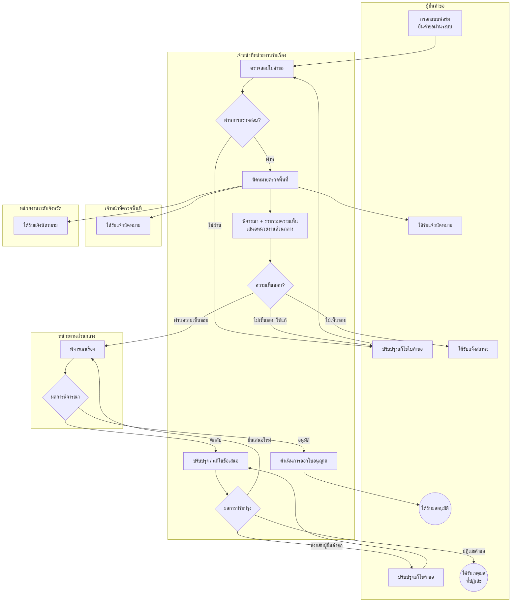

# Online Permit Application System (Case Study)

ระบบเว็บยื่นและพิจารณาคำขออนุญาตใช้พื้นที่ของรัฐ ผู้ยื่นคำขอกรอกแบบฟอร์มและติดตามสถานะผ่านระบบ ส่วนเจ้าหน้าที่หลายหน่วยงานตรวจสอบ นัดหมาย ให้ความเห็น และพิจารณาอนุมัติตามลำดับขั้นตอน ปัจจุบันเปลี่ยนจากการยื่นเอกสารกระดาษเป็นแบบฟอร์มออนไลน์

> **หมายเหตุ:** เป็นงานของลูกค้าหน่วยงานภาครัฐ จึงไม่เปิดเผยชื่อหน่วยงาน โค้ด และข้อมูล ชื่อหน่วยงานในแผนภาพเป็นชื่อสมมติเชิงบทบาทเท่านั้น

**ลักษณะงาน:** โปรเจกต์ทีม (ผู้พัฒนา 5 คน รวมนักศึกษาฝึกงาน) พ.ย. พ.ศ. 2567 – เม.ย. พ.ศ. 2568 (2024–2025) ส่วนที่ผมทำเป็นฝั่ง frontend
**สถานะ:** ส่งมอบให้ลูกค้าแล้ว
**โค้ด:** อยู่ใน private repository ยินดีอธิบายเชิงเทคนิคในการสัมภาษณ์

---

## ขั้นตอนการทำงานของระบบ

มี 5 บทบาทที่ทำงานต่อเนื่องกัน ได้แก่ ผู้ยื่นคำขอ, เจ้าหน้าที่หน่วยงานรับเรื่อง, เจ้าหน้าที่ตรวจพื้นที่, หน่วยงานระดับจังหวัด และหน่วยงานส่วนกลาง

**จุดที่ซับซ้อนของ workflow**
- ผ่านขั้นตรวจสอบแล้ว ระบบ **แจ้งนัดหมายไปหลายฝ่ายพร้อมกัน** ในขณะที่เจ้าหน้าที่เริ่มรวบรวมความเห็น (ทำงานคู่ขนาน)
- คำขอ **วนกลับได้หลายรอบ** ระหว่างผู้ยื่นคำขอ เจ้าหน้าที่ และหน่วยงานส่วนกลาง จึงต้องเก็บประวัติและสถานะของแต่ละรอบให้ครบ
- ทุกบทบาทเห็นเมนูและข้อมูลต่างกันตามหน้าที่และพื้นที่ที่รับผิดชอบ

---

## ส่วนที่ผมรับผิดชอบ (frontend)

เขียนหน้าจอและ logic ฝั่งหน้าเว็บ ทำงานบน branch แยกแล้วรวมเข้าสายหลักร่วมกับทีม

- **หน้าพิจารณาคำขอของเจ้าหน้าที่:** รายการงานทั้งหมด (AllTask), หน้าอนุมัติ/พิจารณา (Approvement), ความเห็น (Comment / EditComment), นัดหมาย (Appointment) ซึ่งเป็นหัวใจของ workflow ด้านบน
- **หน้าแก้ไขคำขอ (editRequest)** ฟอร์มขนาดใหญ่ที่เจ้าหน้าที่แก้ไขข้อมูลคำขอได้ตามสิทธิ์ และหน้ารายการ (listing) พร้อมตัวกรอง
- **ฟอร์มยื่นคำขอของผู้ยื่น:** RequestForm, FormDetail, FormView, MyRequest ตรวจข้อมูลก่อนส่ง
- **หน้าลงนาม / ใบอนุญาต** (SignedLicense) ของหน่วยงานส่วนกลาง
- **จัดการบัญชีผู้ยื่นคำขอ** ฝั่งผู้ดูแลระบบ และหน้า **ดู log การใช้งานระบบ**
- **เมนูและ router** ตามบทบาท (แต่ละบทบาทเห็นเมนูไม่เหมือนกัน)
- **เอกสาร PDF ภาษาไทย:** ตั้งค่า pdfmake พร้อมฟอนต์ไทย (สร้างชุดฟอนต์เอง) เพื่อออกเอกสารตามแบบ
- **อีเมลแจ้งผู้ใช้:** ระบบเดิมส่งอีเมลเป็นข้อความล้วน (plain text) ผมปรับเป็นอีเมล HTML จัดรูปแบบ (ตัวหนา สี ขึ้นบรรทัด) ให้อ่านง่ายและดูเป็นทางการ ทั้งอีเมลแจ้งนัดหมายและแจ้งผลพิจารณา
- **ปรับข้อความและหน้าจอตามเอกสารและความเห็นลูกค้า**

## เทคโนโลยี
Vue 3, Vue Router, Vuex, CoreUI Pro (admin template), Axios, pdfmake, Git (feature branch แล้วรวมเข้า branch งานของทีม)

---

## ปัญหาที่ท้าทาย
1. **workflow วนหลายรอบหลายบทบาท:** ต้องแปลงขั้นตอนบนกระดาษเป็นหน้าจอที่แต่ละบทบาทเห็นเฉพาะงานของตัวเอง และยังย้อนดูประวัติได้ว่าแต่ละรอบใครให้ความเห็นหรือแก้อะไร
2. **ฟอร์มใหญ่และข้อมูลเยอะ:** ฟอร์มแก้ไขคำขอยาวกว่าสองพันบรรทัด จึงแยกเป็นส่วนและตรวจข้อมูลทีละขั้น เพื่อไม่ให้ผู้ใช้กรอกผิดก่อนส่ง
3. **เอกสารราชการภาษาไทย:** การออก PDF ที่ฟอนต์ไทยต้องแสดงถูกต้อง จึงสร้างชุดฟอนต์ให้ pdfmake ใช้ได้ทั้งตอน build และตอนรัน
4. **ลูกค้าปรับถ้อยคำและเงื่อนไขหลายรอบ:** ต้องรอลูกค้าแจ้งข้อความที่ถูกต้องก่อนปิดงาน จึงปรับข้อความบนหน้าจอและในอีเมลตามเอกสารของลูกค้าทีละรอบ

## สิ่งที่ได้เรียนรู้
- เปลี่ยนกระบวนการราชการที่ซับซ้อนให้เป็นระบบออนไลน์ที่ผู้ใช้หลายบทบาทใช้ร่วมกัน
- ทำงานฝั่ง frontend ควบคู่กับสมาชิกที่ดูแล backend
- ทำงานเป็นทีมหลาย branch กับนักศึกษาฝึกงาน ตรวจและรวมงาน
- รับ feedback จากลูกค้าและปรับตามเอกสาร